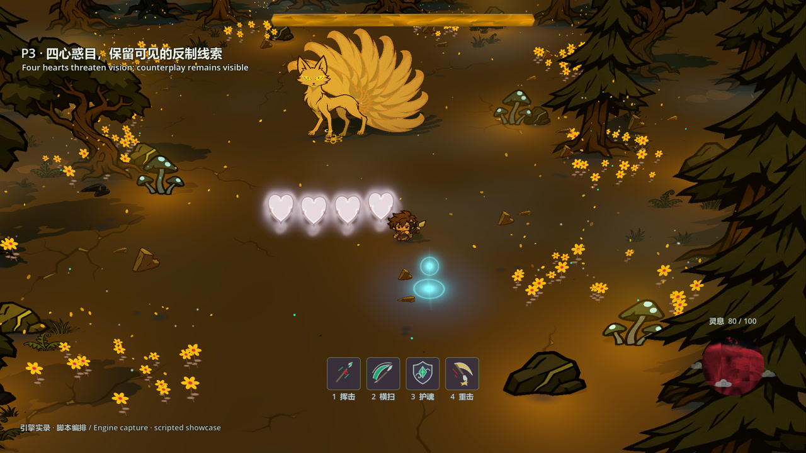

# 青丘 / Qingqiu

**一场从幼狐到九尾的三阶段 Boss 战。**  
A three-phase boss encounter, from a fox cub to a nine-tailed fox.

[观看演示 / Watch](https://luye20010831-commits.github.io/qingqiu-combat-demo/) · [下载 MP4 / Download](media/qingqiu-combat-demo-20261109.mp4) · [中文简历](resume/Lu_Ye_Game_Design_CN_20261109.pdf) · [English CV](resume/Lu_Ye_Gameplay_and_Interactive_AI_EN_20261109.pdf)

## 展示内容 / The encounter

- **单尾幼狐 / One-tailed cub** — 追逐、近身攻击与追踪爱心；短暂魅惑和护魂盾反制。Pursuit, close-range attacks and a homing charm heart, with brief loss of control and a shield counter.
- **双尾迷雾 / Two tails, gathering mist** — 鬼火弹幕、落地黑焰、移动通道与反击间隙。Ghost-fire patterns and falling black flames, with movement routes and windows to counterattack.
- **九尾金瞳 / Nine tails, golden eyes** — 四心魅惑、光点解魅、环形弹幕及金焰转场。Four charm hearts, cleansing lights, circular barrages and golden-fire transitions.

## 我的工作 / My role

陆叶 / Lu Ye — 独立推进玩法规则、视觉方向与制作迭代，组织并调整 AI 辅助代码、生成素材与 Shader，完成工程整合。

Independently led gameplay rules, visual direction and production iteration; selected, adjusted and integrated AI-assisted code, generated assets and shaders.

## 录像说明 / Capture notes

这是 **Godot 引擎实录，原速、静音**。录像通过脚本安排输入、阶段和招式，并设置生命值保护，用于集中展示机制。完整试玩和最终难度调整仍待完成。

Captured in **Godot at normal speed, without audio**. Inputs, stage/attack triggers and health protection are scripted to present the mechanics. Full playtesting and final balance are still pending.

项目处于开发中。可进一步提供可玩 Demo 和开发过程演示。  
Prototype in development. A playable demo and development walkthrough are available.

## 来源 / Credits

The underlying project foundation is [ForlornU / TopdownStarter](https://github.com/ForlornU/TopdownStarter), licensed under MIT. Code and assets were developed with AI assistance, as described above.

